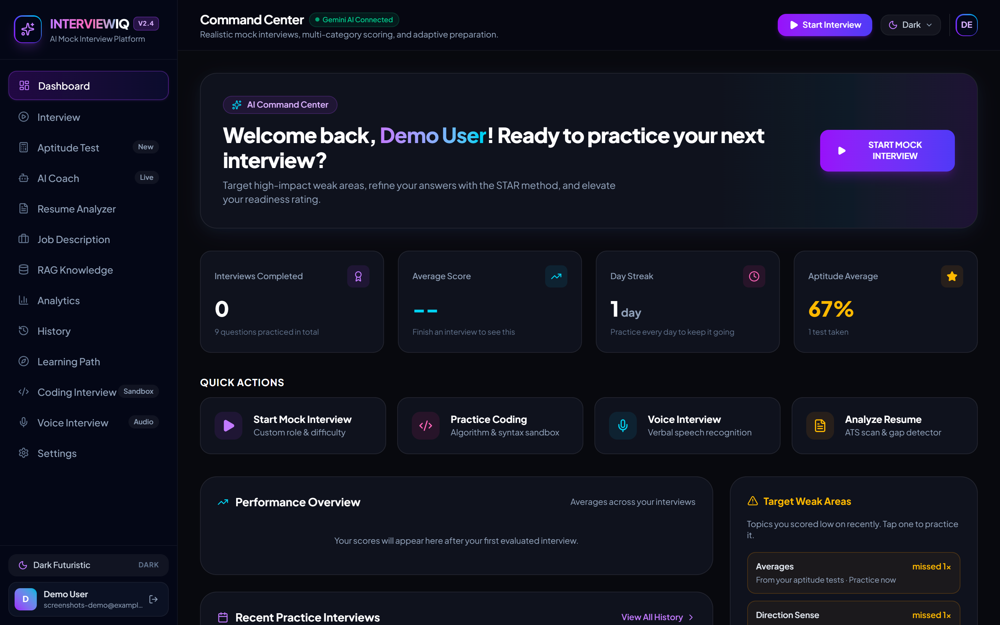
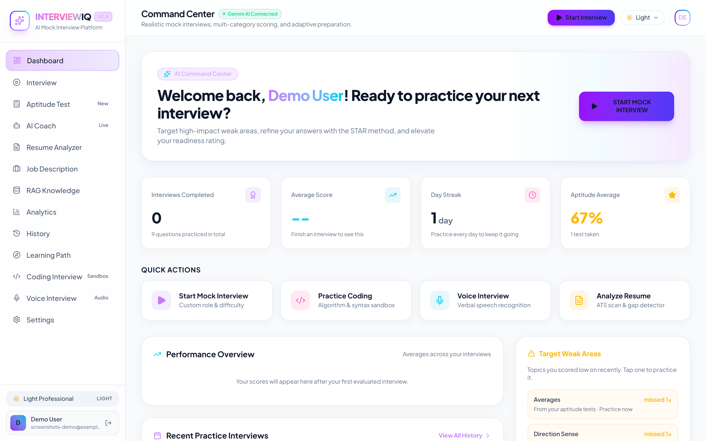
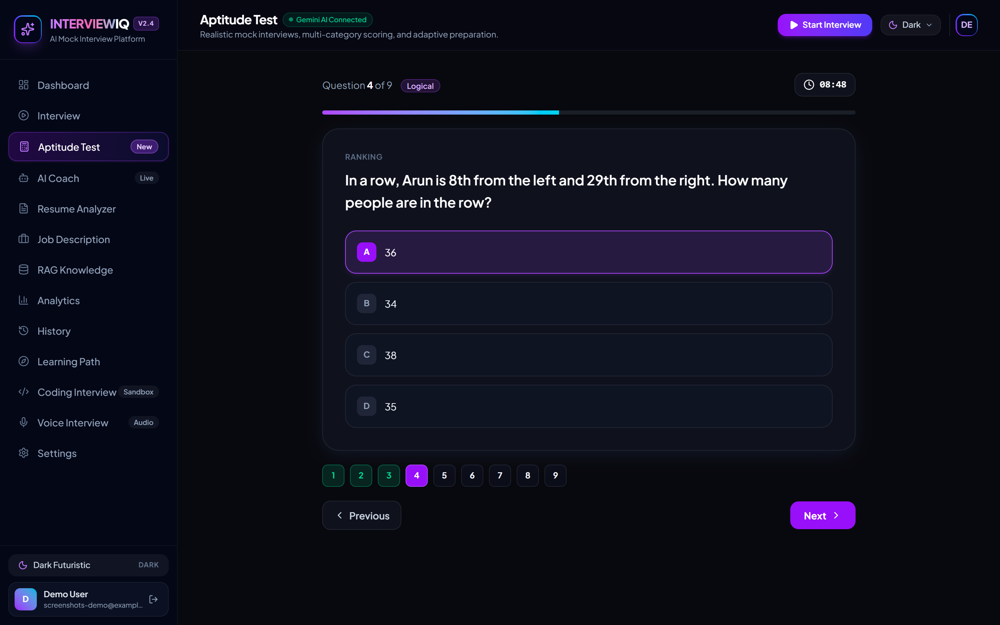
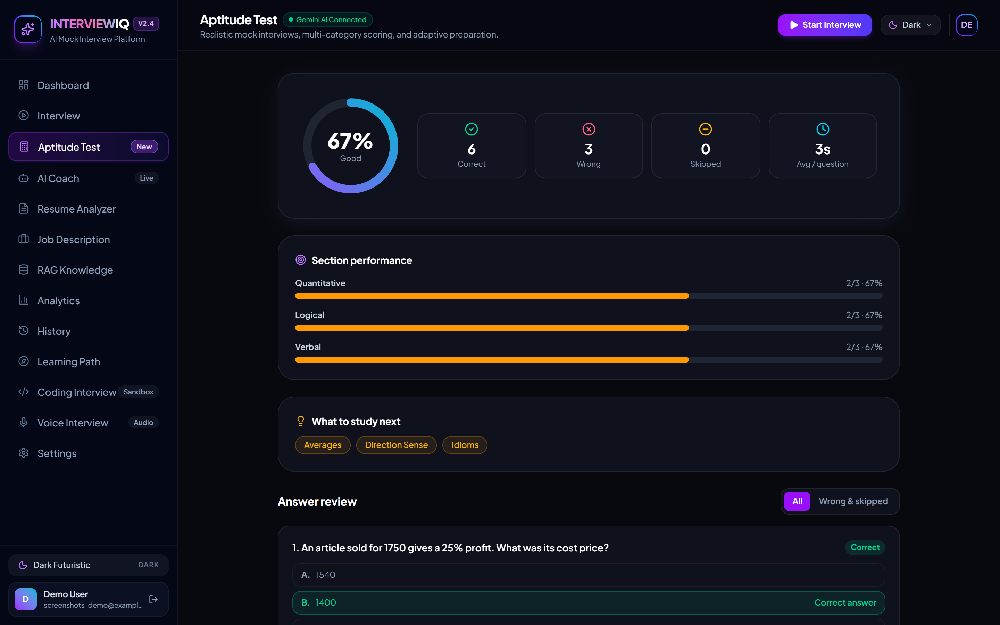
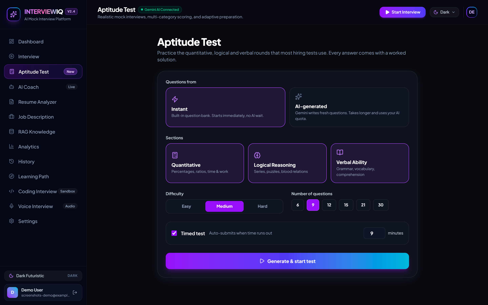
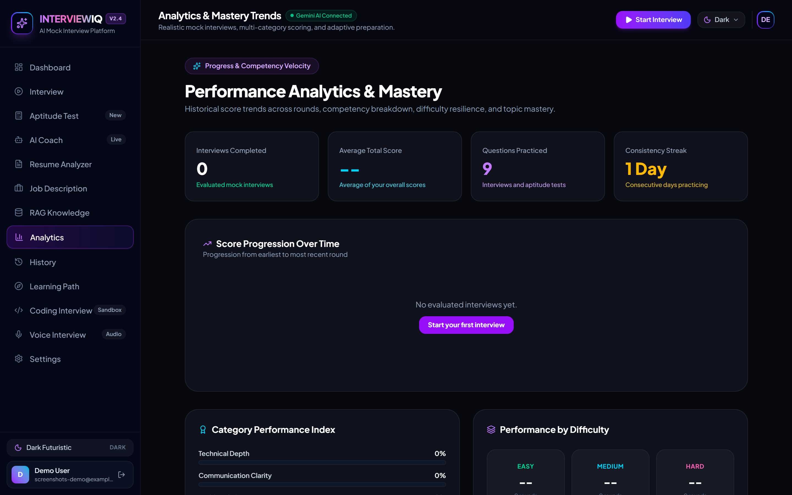

# INTERVIEWIQ — AI-Powered Mock Interview Platform

InterviewIQ is an enterprise-grade AI mock interview platform that helps students, fresh graduates, and job seekers practice realistic interviews, receive granular AI evaluations, improve weak technical and behavioral areas, and prepare for targeted positions.


## 📸 Screenshots

| Dashboard (dark) | Dashboard (light) |
|---|---|
|  |  |

| Aptitude test | Results and worked solutions |
|---|---|
|  |  |

| Setup | Analytics |
|---|---|
|  |  |

---

## 🚀 Key Features

1. **Realistic AI Interviews**
   - Configurable for any technical, behavioral (STAR method), system design, or mixed role.
   - Difficulty levels: Easy, Medium, Hard and Adaptive.
   - **Exact question count guarantee** (5, 10, 15, or 20 questions generated on demand).
   - Multi-modal question formats: Multiple Choice Questions (MCQ) & open-ended technical reasoning.

2. **Multi-Category AI Evaluation**
   - Overall Score, Technical Depth, Communication Clarity, Problem Solving, and Executive Confidence.
   - Question-by-question breakdown with score, constructive feedback, and model exemplar answer.
   - Actionable strengths, weak spots, and recommendations.

3. **Persistent AI Coach**
   - Context-aware career mentor aware of your past sessions and weaknesses.
   - Pre-built drills ("Why did I score low?", "7-Day Prep Roadmap", "STAR behavioral tips").

4. **Resume Intelligence & ATS Scanner**
   - ATS compatibility scoring and structure review.
   - Automated skill gap analysis and customized interview questions drawn directly from resume achievements.

5. **Job Description Analyzer**
   - Match percentage scoring against target job requisitions.
   - Extraction of core competencies, required vs. preferred technologies, and tailored interview topics.

6. **RAG Knowledge Base (Retrieval-Augmented Generation)**
   - Upload interview notes, company dossiers, or tech specs.
   - Semantic chunking and search for interview grounding.

7. **Voice Interview Room**
   - Real-time speech-to-text recognition with visual audio waveform and pause detection.
   - Speech synthesis and simulated conversational interview playback.

8. **Live Coding Interview Sandbox**
   - Interactive code editor supporting Python, JavaScript, TypeScript, Java, and C++.
   - AI evaluation of time/space complexity, edge cases, and code style.

9. **Analytics & Performance Tracking**
   - Interactive score progression charts over time.
   - Category breakdowns, streak counters, and prioritized list of strongest and weakest topics.

10. **Triple-Mode Theming System**
    - Seamless Dark Mode, Light Mode, and System Sync with persistent client state.

---

## 🛠️ Architecture & Tech Stack

- **Frontend**: HTML5, CSS3, TypeScript, React 19, Tailwind CSS v4, Motion animations, Lucide icons.
- **Web server**: Node.js & Express (`server.ts`) serves the Vite app on port 3000 and proxies `/api` to FastAPI.
- **Python Backend**: Python 3.13-compatible, FastAPI, Pydantic v2, SQLAlchemy ORM, SQLite (`sqlite:///./interviewiq.db`), PyJWT, bcrypt, Google GenAI SDK (`from google import genai`).

---

## 💻 Running Locally

InterviewIQ has two parts that must both be running: the **FastAPI backend** (port 8000) and the **web server** (port 3000, Express + Vite). You need Node.js 20+ and Python 3.10+.

```bash
# 1. Install dependencies
npm install
pip install -r requirements.txt

# 2. Configure secrets: copy the template and fill it in
cp backend/.env.example backend/.env
#    GEMINI_API_KEY  -> get one at https://aistudio.google.com/apikey
#    JWT_SECRET      -> python -c "import secrets; print(secrets.token_urlsafe(48))"
```

Then start both servers in two terminals:

```bash
# Terminal 1: backend (run from the project root)
python -m uvicorn backend.app.main:app --port 8000
# or: npm run dev:api

# Terminal 2: frontend
npm run dev
```

Open http://localhost:3000, click **Register**, and you're in. API docs are at http://localhost:8000/docs.

> The instant aptitude test works without a Gemini key. Interviews, AI-generated aptitude questions, the coach and the analyzers need one.

### Tests

```bash
pip install -r requirements-dev.txt
pytest                # backend: auth, privacy, analytics, aptitude, rate limits
npx tsc --noEmit      # frontend type-check
```

The suite uses a throwaway database and a mocked Gemini client, so it needs no API key and never makes network calls. It also re-derives every answer in the instant question bank to prove the answer keys are correct.

> `docker-compose.yml` is a leftover from an earlier Postgres design. It is not currently wired up (there are no Dockerfiles) and the app runs on SQLite, so use the steps above.

---

## 🔐 Accounts, Aptitude & Progress

- **Login required.** Every page except landing/login/register needs an account. Passwords are bcrypt-hashed and sessions use signed JWTs. Each user only ever sees their own interviews, analytics, aptitude results and RAG documents.
- **Aptitude Test** (`/aptitude`). Quantitative, Logical and Verbal sections with difficulty, question count and an optional countdown.
  - *Instant* questions come from a built-in bank (`backend/app/services/aptitude_bank.py`). Answers are computed in code, so they are correct by construction, and there is no AI wait or quota use.
  - *AI-generated* questions come from Gemini and can target specific weak topics.
  - Results include per-section scores, a "what to study" list and a worked solution plus shortcut for every question.
- **Real analytics.** The dashboard and analytics pages are built from your saved interviews and aptitude attempts (score trend, streak, topic strengths and weaknesses). New accounts see empty states, not sample data.
- **Weak-spot practice.** Click a weak topic on the dashboard to start a focused interview or aptitude drill.
- **Saved profile.** Your last interview setup is remembered and prefilled; preferences can be edited in Settings.
- **AI rate limits.** Per-user limits on Gemini-backed endpoints (`AI_DAILY_LIMIT`, `AI_BURST_PER_MINUTE`, in `backend/app/config.py`). Counters are in memory and reset on restart.

### Required configuration

Put these in `backend/.env` (or a root `.env`):

```
GEMINI_API_KEY=your-key
JWT_SECRET=a-long-random-string   # generate: python -c "import secrets; print(secrets.token_urlsafe(48))"
```

`docker-compose.yml` reads `JWT_SECRET` from your environment and refuses to start without it.
